# ChatGPT adapter

The ChatGPT adapter implements read-only keyword search, a bounded conversation list, and optional
message enrichment through an existing logged-in browser session. It supports the personal-account
context verified on 15 October 2026. Workspaces, pagination, and complete-history coverage are not
established and are not inferred.

The adapter is an in-process capability composed by the keyword runtime bridge. The side panel
now invokes its keyword search through a current selected-document binding. No API key, hosted service,
model call, persistence, or additional extension permission is introduced.

## Composition and trust boundaries

```mermaid
flowchart LR
  Owner[Trusted extension owner] --> Binding[AccessBroker document binding]
  Binding --> Factory[createChatGptProvider]
  Factory --> Host[ChromeChatGptReadPort]
  Host --> Guards[Permission, window, tab and Chrome document checks]
  Guards --> Reader[ISOLATED document reader]
  Reader --> Before[Fresh server session and identity]
  Before --> Read[Fixed same-origin GET]
  Read --> After[Fresh server session and identity]
  After --> Parser[Adapter wire validation and normalization]
  Parser --> Outcome[Scoped ProviderOutcome]
```

`AccessBroker.bindSelectedDocument(scope)` returns a trusted, non-serialized capability only for a
current matching selection. Navigation, revocation, reconnect, or broker closure retires that
capability. The Chrome host independently checks the owning window, exact optional permission,
selected regular tab, URL, frame zero, and Chrome document ID before and after injected work.
Replies from a different frame/document, obsolete generation, or interrupted selection are discarded.
There is no arbitrary URL, header, script, or page-command runtime operation.

The document reader runs in Chrome's isolated world. It compares the selected page's bootstrap
user/account identity with a fresh, uncached same-origin landing response, then repeats the identity
check after the provider operation. Only a per-port salted SHA-256 fingerprint leaves the identity
check. The existing ephemeral selection scope remains ephemeral: this does not create a stable
account partition or enable cache reuse or persistence.

Cookie-only API access returned 401 during verification. The reader therefore uses the site's
existing session token transiently **inside the injected browser function**, sending it only to
fixed `https://chatgpt.com` reads. The token is never returned to the extension page/worker, logged,
written to storage, or exported to another process/server. Fresh HTML is parsed as an inert document;
none of its scripts are executed. Unknown bootstrap structure fails closed. A changed account or a
switch from a known selection to an unsupported workspace retires the selection.

## Operations

| API                              | Behavior                                                                                       |
| -------------------------------- | ---------------------------------------------------------------------------------------------- |
| `new ChatGptProvider(scope)`     | Validates and snapshots scope; unavailable without a trusted read port                         |
| `createChatGptProvider(binding)` | Composes the provider with the concrete Chrome host                                            |
| `inspectSession(context)`        | Fresh identity verification; ready only after a successful authenticated check                 |
| `search(request, context)`       | Keyword read for the normalized query text; at most 30 wire matches                            |
| `list(request, context)`         | One verified default list response; no guessed pagination arguments                            |
| `enrich(request, context)`       | Adds bounded API text only to candidates from the latest identical request/query               |
| `invalidate()`                   | Permanently retires the instance, clears retained candidates/identity, and aborts pending work |

The verified keyword route is `GET /backend-api/global/search`, with `query`, `limit=30`,
`sources=conversation`, and a UUID `query_id`. The historical search endpoint is not used.
The list is `GET /backend-api/conversations` without query arguments. Messages are
`GET /backend-api/conversation/{conversation_id}` for retrieved, validated conversation IDs.
An empty keyword query is not a list operation.

The provider does not interpret descriptions or apply server date parameters. Search planning and
result filtering belong to the orchestration layer. Shared date filtering uses `[start, end)`;
unknown dates are disclosed so they cannot silently satisfy a requested range.

## Normalization

Wire schemas remain adapter-owned. Required fields and outer size/count limits are checked at
runtime; additive provider fields are ignored. Malformed envelopes fail rather than producing an
empty result. Conversation identity comes from search `payload.conversation_id`, not the search
result's own `id` or `source_key`. Duplicate matches merge into one scoped conversation with
bounded distinct evidence.

Original links use the verified `https://chatgpt.com/c/{conversation_id}` mapping and canonical UUID
shape. The link verifier rejects alternate origins, paths, credentials, ports, query strings, and
fragments. Models or caller-supplied URLs do not construct links.

Titles and snippets retain their exact text, including whitespace. A bounded prefix is still an
exact excerpt; the adapter never adds ellipses, rewrites punctuation, decodes imagined highlights,
or joins separate message parts into invented quotations. Native snippets use `native-snippet`
provenance; a title fallback uses `title`. API text uses the separate `provider-message` provenance.
Clipping preserves complete UTF-16 characters at title/excerpt boundaries and repeats the same check
when an API excerpt reaches the aggregate evidence budget.

Message enrichment walks parent pointers from `current_node`, rejects cycles/dangling references,
and reads only that active branch in chronological order. It excludes system/tool messages,
hidden messages, analysis channels, and unsupported content types. Each supported text part remains
separate. Enrichment reads at most three retrieved conversations and extracts at most four text
parts per conversation; it stops issuing reads when the evidence budget is full.

Search `update_time` is Unix seconds; list `update_time` is a UTC ISO string. Both normalize to
canonical millisecond UTC with `conversation-updated` meaning and `provider-metadata` provenance.
Search and message update metadata matched for the same conversation during verification. Invalid
or missing dates remain absent; creation time is not substituted for update time.

## Bounds and failures

Each document read has an eight-second deadline, a 2 MiB limit per HTML/JSON response, strict UTF-8
and MIME checks, and at most two concurrent document controllers. The Chrome host has a separate
9.5-second deadline; the provider has a ten-second operation deadline. There are no retries.
Cancellation settles the caller, aborts dispatched reads where possible, and discards late replies.

Normalized limits are 100 candidates, 300 title characters, 2,000 characters per excerpt, eight
pieces of evidence per candidate, and 64,000 evidence characters per outcome. The message graph is
bounded to 2,048 nodes. These limits can exclude large conversations; they are not a full-history or
complete-transcript guarantee.

| Condition                                                       | Outcome                                                                        |
| --------------------------------------------------------------- | ------------------------------------------------------------------------------ |
| HTTP 401                                                        | `login-expired`, followed by permanent instance retirement                     |
| Missing/revoked Chrome permission                               | `permission-needed`                                                            |
| HTTP 429                                                        | `rate-limited`, with an optional valid Retry-After hint capped at five minutes |
| HTTP 403/5xx/other non-200 or redirect                          | `unavailable`                                                                  |
| Wrong MIME, oversized/invalid UTF-8/JSON, incompatible envelope | `schema-changed`                                                               |
| Deadline, cancellation, changed identity/document, lost context | `timeout`, `cancelled`, `scope-changed`, or `interrupted`                      |
| Valid no-match response                                         | `success` with an empty candidate list and explicit coverage                   |

Coverage always discloses unknown history reach. Cursor/partial flags, source continuation signals,
or a bounded list add `result-limit`; no cursor semantics or offsets are invented. Enrichment adds
`missing-evidence` and, when appropriate, `query-budget`. Failures carry correlation and status,
without raw provider bodies, query text, or exception messages.

## Verification and limits

Actual unpacked-extension reads on 15 October 2026 verified a ready personal session; five
conversations for the same native keyword query, with all five native titles matching; five native
snippets, dates, and original links; four exact API text excerpts; a deliberate zero-result query;
and a 50-conversation list marked partial. A passive original-link reopen preserved the source tab,
confirmed the same account, and closed its temporary tab. That probe did not establish rendered
message equivalence; API text remains labeled `provider-message`.

These reads used the actual provider, Chrome host, broker selection, and isolated reader from a
temporary trusted extension diagnostic. They do not establish the side-panel sender handshake or a
shipped search UI. Live logout/account switching, forced HTTP failures, and every Chrome lifecycle
race were not induced; synthetic tests cover those cases separately.

Production currently requires the selected ChatGPT tab and its existing browser login. Background
development automation is not proof of tab-free production support. OpenAI's supported
[Sign in with ChatGPT](https://developers.openai.com/siwc/quickstart) authenticates an application
identity or eligible inference usage; it does not grant access to saved ChatGPT conversations.

See [development notes](development.md) and [test coverage](testing.md) for integration and commands.
