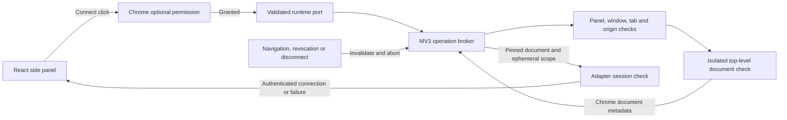

# Technical foundation

The [side panel](sidepanel.md) owns the search form, connection state, and description ranking.
The service worker binds provider documents and runs the [keyword engine](keyword-search.md)
against the [ChatGPT](chatgpt-adapter.md) and [Google Search AI Mode](google-ai-mode-adapter.md)
adapters. Each adapter reads within the connected browser session and returns scoped candidates
with exact evidence. Before displaying a completed search, the panel asks the worker to verify
each successful provider against the original scope.

For [description search](description-search.md), the panel retrieves candidates through the same
worker and ranks their evidence using literal matching or explicitly enabled [on-device AI](on-device-ai.md).
Queries, excerpts and results stay in memory. Only the versioned search-mode preference persists
in extension-local storage. See [privacy and data handling](privacy.md).

## Shared contracts

`src/contracts/` defines strict TypeScript types through Valibot runtime schemas. This keeps the
provider, search, model, storage and UI layers on one normalized vocabulary. Unknown keys, malformed
types, excessive arrays/text and unsafe metadata are rejected at the boundary. `validate` returns a
typed value or the generic `invalid-contract` code; `requireValid` throws a safe generic error when
a caller constructs an invalid validation context. Neither exposes raw input or validator issues.

| Contract           | Meaning and validation                                                                                                                                                                                                  |
| ------------------ | ----------------------------------------------------------------------------------------------------------------------------------------------------------------------------------------------------------------------- |
| Session scope      | A provider, account/workspace partition and generation for verified identity, or a fresh ephemeral partition when identity is unknown. A schema label alone does not verify an account.                                 |
| Query/request      | Bounded trimmed query, keyword/description mode, explicit providers/timezone, optional canonical UTC date range, unique request ID and one scope for each requested provider. Dates use `[start, end)`.                 |
| Candidate/evidence | Opaque conversation/candidate/evidence IDs, optional observed title/date/link, exact excerpts and provenance. Unknown metadata stays absent; titles are not identity keys.                                              |
| Outcomes/coverage  | Provider success is distinct from login, permission, schema, rate-limit, cancellation, timeout and interruption failures. Aggregate completion must agree with provider outcomes and disclose limits/failures.          |
| Model output       | Topic/keyword suggestions and scored references to retrieved candidate/evidence IDs. Models cannot supply new quotes, links, dates or override explicit filters. Application code retains the actual evidence/metadata. |
| Optional cache     | Versioned verified-scope entries with matching candidate scope, a positive bounded TTL and current clock/link checks. These schemas implement no storage or opt-in flow.                                                |

Provider, search, model and storage ports are dependency-injected interfaces with `AbortSignal`
contexts. Their existence does not initiate reads or inference. External output remains `unknown`
until a contextual schema verifies the active request, complete scope/generation and adapter link
policy. Shared contracts import no Chrome APIs or provider wire formats.

## Chrome access

The required installation permission is `sidePanel`. Connect synchronously requests optional
`scripting` and one exact candidate host: `https://chatgpt.com/*` or `https://www.google.com/*`.
The background configures the toolbar action through Chrome's native panel behavior. Incognito is
disabled; broad browsing, cookie, debugger and storage permissions are absent.

The port accepts bounded access commands, including `connect`, `inspect-context`, `verify-session`,
`disconnect` and `cancel`. Search commands cover keyword search, description retrieval, cancellation
and release of description context. The worker selects read targets from the validated inventory.
The receiving worker validates Chrome's sender metadata and independently
finds the live regular-profile side panel. Panel code calls `windows.getCurrent` in its own document
and includes the resulting window ID in the port name. The worker pins that binding, verifies the
window still exists outside incognito, and resolves independent completed provider source tabs.
A suitable existing source can remain inactive; if none is available, Connect prepares a fixed
provider landing page in a background tab. No arbitrary account/tab/URL selector crosses the port. Global
panel runtime contexts report `windowId: -1`; they verify panel identity rather than select a window.
Provider operation messages cannot override the bound window or frame.

The fixed script runs in `ISOLATED`, initially in frame 0. It returns only origin/top-level status.
Chrome's injection metadata supplies the document ID; confirmation and later inspection target
that exact document. The broker also rechecks tab, permission and owning panel. No page text,
credentials, session identity or provider endpoint is read by this function.

Connect and explicit context inspection establish a fresh ephemeral partition and generation.
The adapter checks account identity before the panel can mark that scope Connected. A confirmed
sign-out during connection starts a cancellable provider-managed sign-in flow with a five-minute
deadline. On return, the worker binds the new document and checks the session again.
The final pre-display verification checks the existing scope and generation.

The worker permits one pending access operation per provider and up to four connected panel brokers.
The access and search brokers each bound their request-ID history to 256 entries per port.
Ordinary access operations have a 10-second worker deadline and a 12-second panel watchdog.
Cancellation aborts pending work and discards late output. Request IDs correlate replies.
Generation numbers prevent old invalidation events from clearing a newer selection.

Loading/navigation, URL changes and removal/replacement of a bound source, permission removal
and port loss invalidate access. Tab/window focus changes retain independent provider bindings.
While a scope or connection attempt is active, the panel sends a heartbeat every 20 seconds.
The worker acknowledges it and, while idle, rechecks verified provider sessions. A pending check
for the same provider prevents a duplicate. Failed checks retire the binding and clear stale results.
The timer stops when the panel closes or has neither scopes nor pending attempts. After worker loss,
Connect opens a fresh port. Disconnect releases in-memory access. Chrome settings control site grants.

## Verification

The [acceptance matrix](acceptance.md) distinguishes authenticated provider checks from isolated
Chromium tests of the native panel with synthetic provider responses. Those tests exercise the panel,
worker and document readers together. Real user-completed login/MFA return and on-device inference
remain unverified in the recorded test environment. See the [test suites](testing.md) for coverage.
