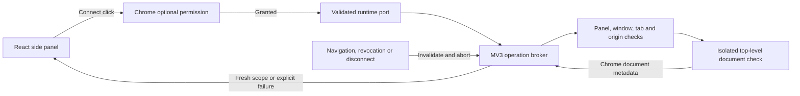

# Technical foundation

ThreadShelf currently has a validated data model and a bounded Chrome document-access layer.
Conversation retrieval, provider identity discovery, search orchestration, model inference and
persistent storage remain unavailable. Selecting a provider site checks browser context only and
always reports an unverified session.

## Shared contracts

`src/contracts/` defines strict TypeScript types through Valibot runtime schemas. This keeps the
provider, search, model, storage and UI layers on one normalized vocabulary. Unknown keys, malformed
types, excessive arrays/text and unsafe metadata are rejected at the boundary. `validate` returns a
typed value or the generic `invalid-contract` code; `requireValid` throws a safe generic error when
a caller constructs an invalid validation context. Neither exposes raw input or validator issues.

| Contract           | Meaning and validation                                                                                                                                                                                                  |
| ------------------ | ----------------------------------------------------------------------------------------------------------------------------------------------------------------------------------------------------------------------- |
| Session scope      | A provider, account/workspace partition and generation for verified identity, or a fresh ephemeral partition when identity is unknown. A schema label alone does not verify an account.                                 |
| Query/request      | Bounded trimmed query, keyword/description mode, explicit providers/timezone, optional canonical UTC date range, unique request ID and one scope for each requested provider. Dates use `[start, end)`.                 |
| Candidate/evidence | Opaque conversation/candidate/evidence IDs, optional observed title/date/link, exact excerpts and provenance. Unknown metadata stays absent; titles are not identity keys.                                              |
| Outcomes/coverage  | Provider success is distinct from login, permission, schema, rate-limit, cancellation, timeout and interruption failures. Aggregate completion must agree with provider outcomes and disclose limits/failures.          |
| Model output       | Topic/keyword suggestions and scored references to retrieved candidate/evidence IDs. Models cannot supply new quotes, links, dates or override explicit filters. Application code retains the actual evidence/metadata. |
| Optional cache     | Versioned verified-scope entries with matching candidate scope, a positive bounded TTL and current clock/link checks. These schemas implement no storage or opt-in flow.                                                |

Provider, search, model and storage ports are dependency-injected interfaces with `AbortSignal`
contexts. Their existence does not initiate reads or inference. External output remains `unknown`
until a contextual schema verifies the active request, complete scope/generation and adapter link
policy. Shared contracts import no Chrome APIs or provider wire formats.

## Chrome access

The required installation permission is `sidePanel`. Connect synchronously requests optional
`scripting` and one exact candidate host: `https://chatgpt.com/*` or `https://www.google.com/*`.
The background configures the toolbar action through Chrome's native panel behavior. Incognito is
disabled; broad browsing, cookie, debugger and storage permissions are absent.

The only allowed messages are `connect`, `inspect-context`, `disconnect` and `cancel`, with bounded
IDs/providers/scopes. Caller-supplied URLs, tab IDs, headers, bodies or executable code cannot
reach the script API. The receiving worker validates Chrome's sender metadata and independently
finds the live regular-profile side panel. It uses that panel's window to select an active completed
provider tab; caller assertions cannot select a different window or frame.

The fixed script runs in `ISOLATED`, initially in frame 0. It returns only origin/top-level status.
Chrome's injection metadata supplies the document ID; confirmation and later inspection target
that exact document. The broker also rechecks tab, permission and owning panel. No page text,
credentials, session identity or provider endpoint is read by this function.

Each successful check replaces the previous unknown scope with a fresh ephemeral partition and
generation. There is no cache or persistence. Account/workspace switches and logout within the
same document are not yet observed; future adapters must establish identity around actual reads
before results can be displayed or stored.

The worker permits one pending operation per provider, four panel brokers and 256 unique IDs per
port. It sets a 10-second deadline. The panel client independently sets a 12-second deadline so a
silent/suspended worker cannot leave an operation pending indefinitely. Cancellation aborts signals,
prevents subsequent checks and discards late output. Request IDs correlate replies, while generation
high-water marks prevent old invalidation events from clearing a newer selection.

Loading/navigation, URL changes, removed/replaced/activated tabs, focus changes, permission removal
and port loss invalidate access. Scope disappears before terminal worker replies. Worker loss is
explicit `interrupted` behavior; the next Connect opens a fresh port. Clear selection releases
memory; Chrome settings own permission revocation. Cancelling a native permission prompt blocks
later access but cannot dismiss Chrome's prompt itself.

## Test evidence and remaining work

The test follow-up adds 265 regression cases to the original 262, including defective inputs,
exhaustive provider-status combinations, cancellation at every asynchronous broker boundary,
queued real client/broker interaction, serialized probe execution and DOM panel flows. It also fixes
the separate disconnect-error listener retained during unmount and inherited status-key lookup
errors in the shared view. See [test coverage](testing.md) for
commands, the test matrix and measured coverage.

All automated Chrome interactions use synthetic metadata or mocks. Real unpacked-extension
authentication/context behavior remains unverified. Provider transports, original conversation
URL/date mapping, reliable account/workspace identity and history coverage require separate live
evidence before conversation search can be implemented.
