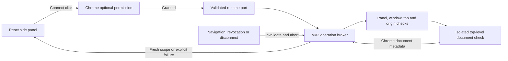

# Technical foundation

ThreadShelf currently has a validated data model and a bounded Chrome document-access layer.
The [ChatGPT adapter](chatgpt-adapter.md) adds verified personal-account reads and transient identity
checks. The [keyword engine](keyword-search.md) coordinates injected providers, filters, deduplication,
cancellation and bounded outcomes. Model inference and persistent storage remain unavailable. The
[shadcn/ui panel](sidepanel.md) now connects keyword controls to the engine and real provider
adapters through a validated runtime search bridge. A selected document stays unverified until
the provider checks account identity around a search.

## Shared contracts

`src/contracts/` defines strict TypeScript types through Valibot runtime schemas. This keeps the
provider, search, model, storage and UI layers on one normalized vocabulary. Unknown keys, malformed
types, excessive arrays/text and unsafe metadata are rejected at the boundary. `validate` returns a
typed value or the generic `invalid-contract` code; `requireValid` throws a safe generic error when
a caller constructs an invalid validation context. Neither exposes raw input or validator issues.

| Contract           | Meaning and validation                                                                                                                                                                                                  |
| ------------------ | ----------------------------------------------------------------------------------------------------------------------------------------------------------------------------------------------------------------------- |
| Session scope      | A provider, account/workspace partition and generation for verified identity, or a fresh ephemeral partition when identity is unknown. A schema label alone does not verify an account.                                 |
| Query/request      | Bounded trimmed query, keyword/description mode, explicit providers/timezone, optional canonical UTC date range, unique request ID and one scope for each requested provider. Dates use `[start, end)`.                 |
| Candidate/evidence | Opaque conversation/candidate/evidence IDs, optional observed title/date/link, exact excerpts and provenance. Unknown metadata stays absent; titles are not identity keys.                                              |
| Outcomes/coverage  | Provider success is distinct from login, permission, schema, rate-limit, cancellation, timeout and interruption failures. Aggregate completion must agree with provider outcomes and disclose limits/failures.          |
| Model output       | Topic/keyword suggestions and scored references to retrieved candidate/evidence IDs. Models cannot supply new quotes, links, dates or override explicit filters. Application code retains the actual evidence/metadata. |
| Optional cache     | Versioned verified-scope entries with matching candidate scope, a positive bounded TTL and current clock/link checks. These schemas implement no storage or opt-in flow.                                                |

Provider, search, model and storage ports are dependency-injected interfaces with `AbortSignal`
contexts. Their existence does not initiate reads or inference. External output remains `unknown`
until a contextual schema verifies the active request, complete scope/generation and adapter link
policy. Shared contracts import no Chrome APIs or provider wire formats.

## Chrome access

The required installation permission is `sidePanel`. Connect synchronously requests optional
`scripting` and one exact candidate host: `https://chatgpt.com/*` or `https://www.google.com/*`.
The background configures the toolbar action through Chrome's native panel behavior. Incognito is
disabled; broad browsing, cookie, debugger and storage permissions are absent.

Access messages are `connect`, `inspect-context`, `disconnect` and `cancel`, with bounded
IDs/providers/scopes. The panel also has a validated keyword/cancellation bridge and empty local
keepalive messages. Caller-supplied URLs, tab IDs, headers, bodies or executable code cannot
reach the script API. The receiving worker validates Chrome's sender metadata and independently
finds the live regular-profile side panel. Panel code calls `windows.getCurrent` in its own document
and includes the resulting window ID in the port name. The worker pins that binding, verifies the
window still exists outside incognito, and resolves independent completed provider source tabs.
A suitable existing source can remain inactive; if none is available, Connect prepares a fixed
provider landing page in a background tab. No arbitrary account/tab/URL selector crosses the port. Global
panel runtime contexts report `windowId: -1`; they verify panel identity rather than select a window.
Provider operation messages cannot override the bound window or frame.

The fixed script runs in `ISOLATED`, initially in frame 0. It returns only origin/top-level status.
Chrome's injection metadata supplies the document ID; confirmation and later inspection target
that exact document. The broker also rechecks tab, permission and owning panel. No page text,
credentials, session identity or provider endpoint is read by this function.

Each successful check replaces the previous unknown scope with a fresh ephemeral partition and
generation. There is no cache or persistence. Account/workspace switches and logout within the
same document are not observed by these setup-only checks. The ChatGPT adapter separately
verifies fresh identity around actual reads; unknown durable identity still prohibits persistence.

The worker permits one pending operation per provider, four panel brokers and 256 unique IDs per
port. It sets a 10-second deadline. The panel client independently sets a 12-second deadline so a
silent/suspended worker cannot leave an operation pending indefinitely. Cancellation aborts signals,
prevents subsequent checks and discards late output. Request IDs correlate replies, while generation
high-water marks prevent old invalidation events from clearing a newer selection.

Loading/navigation, URL changes and removal/replacement of a bound source, permission removal
and port loss invalidate access. Tab/window focus changes retain independent provider bindings.
A connected panel sends local 20-second keepalive messages without provider reads; timers stop
when scopes or the panel close. Scope disappears before terminal worker replies. Worker loss is
explicit `interrupted` behavior; the next Connect opens a fresh port. Disconnect under Connection
options releases memory; Chrome settings own permission revocation. Cancelling a native permission prompt blocks
later access but cannot dismiss Chrome's prompt itself.

## Test evidence and remaining work

The test follow-up adds 265 regression cases to the original 262, including defective inputs,
exhaustive provider-status combinations, cancellation at every asynchronous broker boundary,
queued real client/broker interaction, serialized probe execution and DOM panel flows. It also fixes
the separate disconnect-error listener retained during unmount and inherited status-key lookup
errors in the shared view. See [test coverage](testing.md) for
commands, the test matrix and measured coverage.

Automated tests use synthetic metadata and mocked Chrome APIs. Separate read-only verification
established personal-account ChatGPT transport, identity checks, original links, dates and exact
API evidence in an actual unpacked extension. The [adapter reference](chatgpt-adapter.md) records
that proof and its limits. Side-panel sender acceptance, workspaces, pagination and full-history
coverage remain separate from the verified adapter behavior.
