# Google Search AI Mode adapter

The Google Search AI Mode adapter implements read-only keyword search, a bounded saved-thread list,
and optional rendered-thread evidence through an existing logged-in browser session. It supports
the default-account context on `https://www.google.com/search?udm=50` verified on 15 October 2026.
It does not use the Gemini app. Nondefault account selection, other Google locale hosts, timestamp
meanings, pagination and complete-history coverage remain unsupported or unverified.

The adapter is an in-process capability consumed through normalized provider ports. Shared search
orchestration and side-panel composition are separate from its transport and parser. No API key,
hosted service, model call, persistence or additional extension permission is introduced.

## Composition and trust boundaries

```mermaid
flowchart LR
  Owner[Trusted extension owner] --> Binding[AccessBroker document binding]
  Binding --> Factory[createGoogleAiModeProvider]
  Factory --> Host[ChromeGoogleAiModeReadPort]
  Host --> Guards[Permission, window, tab and Chrome document checks]
  Guards --> Reader[ISOLATED document reader]
  Reader --> Before[Fresh account identity check]
  Before --> Read[Fixed same-origin search or list GET]
  Read --> After[Fresh account identity check]
  After --> Parser[Adapter wire validation and normalization]
  Parser --> Outcome[Scoped ProviderOutcome]
```

`AccessBroker.bindSelectedDocument(scope)` supplies a trusted, non-serialized capability for the
current selected document. The concrete host requires a matching ephemeral Google scope. Before
and after work, it checks the owning panel/window, optional permission, active regular source tab,
exact source URL and Chrome-pinned top-level document. Injection replies must independently match
frame zero and the expected Chrome document ID. No runtime operation accepts arbitrary URLs,
headers, account selectors or executable code.

The document reader executes in Chrome's isolated world. It compares the rendered Google account
control with a fresh, uncached same-origin AI Mode landing response before and after each operation.
Identity comes from the final parenthesized account address in the account control, rather than
email-like display-name text. Missing identity fails closed; differing identities produce
`scope-changed`. The adapter also pins the fingerprint between operations.

Only an ephemeral-partition-salted SHA-256 fingerprint leaves the identity check; account labels
and addresses are not returned. Authentication remains browser-managed through same-origin requests;
there is no credential extraction or custom authorization header. Fresh HTML is parsed as an inert
document without executing its scripts. These checks do not establish a durable verified account
partition or enable cache reuse. A URL containing an `authuser` selector is rejected rather than
silently falling back to the default account.

## Operations

| API                                          | Behavior                                                                                                        |
| -------------------------------------------- | --------------------------------------------------------------------------------------------------------------- |
| `new GoogleAiModeProvider(scope)`            | Validates and snapshots scope; unavailable without a trusted read port                                          |
| `createGoogleAiModeProvider(binding)`        | Composes the provider with the concrete Chrome host                                                             |
| `inspectSession(context)`                    | Fresh identity verification; ready only after a valid successful inspection                                     |
| `search(request, context)`                   | Native keyword read for normalized query text; at most 30 wire matches                                          |
| `list(request, context)`                     | One bounded native list response; at most 300 wire records, normalized to at most 100 candidates                |
| `messages(request, conversationId, context)` | Returns one retrieved candidate enriched with bounded rendered evidence from the latest identical request/query |
| `invalidate()`                               | Permanently retires the instance, clears identity/candidate inventory and aborts pending work                   |

Search uses `GET /httpservice/web/AimThreadsService/SearchThreads`, with `udm=50` and
`reqpld` containing the JSON array `[query,30,null,2,null,0]`. Listing uses
`GET /httpservice/web/AimThreadsService/ListThreads`, with `udm=50` and
`reqpld=[null,null,0]`. These are observed internal website interfaces, not a documented public
Google API contract. No continuation arguments, account selectors or complete-message endpoint
are inferred. Empty keyword input is not a substitute for listing.

The provider does not interpret descriptions or send server date filters. The
[keyword search engine](keyword-search.md) owns provider selection and deterministic date filtering.
Since Google supplies no verified normalized dates, these candidates cannot satisfy a date filter;
the outcome discloses `unknown-dates`.

## Normalization

`wire.ts` owns the XSSI-prefixed JSON parser, bounded positional records, URL policy and HTTP mapping.
Successful bodies start with `)]}'`. Search returns a bounded match array; the observed genuine
no-match envelope is `[]`. List responses contain a bounded first array; other observed list fields
are not interpreted as continuation tokens. Malformed or missing envelopes never become empty success.

Conversation identity uses the observed short thread ID. Duplicate records merge bounded distinct
snippets; conflicting original-link metadata or raw titles fail validation, including conflicting
titles too long to display. Candidate IDs are independently generated opaque references scoped to
the request's provider/session generation. Equal titles do not merge unrelated conversations.

Original links use the exact `https://www.google.com/search` route and four observed metadata pairs:
`mtid` equals the short thread ID, `mstk` equals the observed long state, `csuir=1` and `udm=50`.
The verifier rejects credentials, ports, fragments, other origins/paths, missing or duplicate keys,
unknown parameters and mismatched IDs. Links are not generated from titles, model output or caller URLs.

Titles remain exact when within the 300-code-unit display bound; missing or overlong titles are
omitted. Native snippets remain exact plain-text substrings with `native-snippet` provenance;
title evidence uses `title`. Clipping adds no ellipses, rewrites no punctuation and preserves UTF-16
surrogate pairs. Omitted or clipped evidence is disclosed with `missing-evidence`.

Observed timestamp pairs and relative labels have no verified creation/update meaning. Normalized
dates are deliberately absent. Numeric positions are not relabeled as creation dates, last-update
times or invented midnight instants. Available-date filtering retains that uncertainty.

## Rendered evidence

There is no verified complete-message API. `messages` accepts only an ID retained by this adapter
from its latest successful retrieval with the exact originating request ID and query. A failed or
replacement retrieval clears that inventory, and mutations to returned results cannot rebind it.
The read port must supply the optional trusted `openEvidence` capability; otherwise evidence is
explicitly unavailable. The host's generic `read` method rejects direct `messages` operations.

The concrete host rechecks source identity, opens the retrieved original link in an owned passive
background tab, validates its URL/document and reads only the observed visible `[data-last-turn]`
blocks. It extracts at most four exact excerpts of 2,000 UTF-16 code units each, subject to the shared
eight-item candidate evidence bound. Provenance is `rendered-message`, with `unknown-reach` and
`missing-evidence` coverage. This is partial rendered evidence, not a complete transcript.

The host verifies the temporary URL/document after extraction and rechecks the original source
context/account. It closes only its owned tab in `finally`, including cleanup when tab creation
finishes after cancellation. The source tab remains selected; opening evidence does not navigate it.

## Bounds and failures

Each isolated document operation has an eight-second deadline, a 3,000,000-byte streaming response
cap, strict UTF-8 decoding, MIME checks and at most four concurrent document controllers. The wire
parser separately bounds decoded body length to 3,000,000 UTF-16 code units. The Chrome host has a
9.5-second deadline, and the provider has an independent ten-second operation deadline. There are
no adapter retries. The shared search engine separately owns aggregate budgets and rate cooldowns.

Normalized limits are 100 candidates, 300 title code units, 2,000 code units per excerpt, eight
evidence items per candidate and 64,000 evidence code units per retrieval outcome. Reaching a native
30-match/300-record limit or the normalized candidate cap adds `result-limit`; none establishes that
all saved threads were searched or listed. Search/list coverage always retains `unknown-reach` and
becomes partial when `result-limit` applies.

| Condition                                                                      | Outcome                                                                           |
| ------------------------------------------------------------------------------ | --------------------------------------------------------------------------------- |
| No bound read port or unsupported evidence capability/context                  | `unavailable`                                                                     |
| HTTP 401                                                                       | `login-expired`, with permanent instance retirement                               |
| Missing/revoked Chrome permission                                              | `permission-needed`; a received permission failure retires the instance           |
| HTTP 429 from search/list                                                      | `rate-limited`, with an optional positive Retry-After hint capped at five minutes |
| HTTP 429 during account inspection                                             | `rate-limited`, without a retry hint                                              |
| Other non-200 status, manual/opaque redirect or unexpected transport exception | `unavailable`                                                                     |
| Wrong MIME, oversized response, malformed XSSI/JSON or incompatible envelope   | `schema-changed`                                                                  |
| Deadline, caller cancellation, changed account/document or lost context        | `timeout`, `cancelled`, `scope-changed` or `interrupted`                          |
| Valid no-match response                                                        | `success` with zero candidates and explicit coverage                              |

Cancellation/replacement aborts pending work where possible and discards late responses. Navigation,
source-tab removal/replacement, activation/focus changes and relevant permission revocation interrupt
the host. Unrelated permission removals do not invalidate a Google read. Timers, listeners and owned
tabs are cleaned up. Lifecycle owners must retire the provider with its selection and clear displayed
results; `invalidate()` is a lifecycle seam rather than an independent account observer. Failure
outcomes contain correlation and status, without raw response bodies, account text or exception messages.

## Verification and limits

Read-only verification on 15 October 2026 used the existing default account in native Google Search
and the actual unpacked extension in Chrome 155.0.8059.40. Isolated-world reads returned three keyword
matches whose titles omitted the keyword, a deliberate zero-result response, 100 normalized candidates
from a 300-record list and a ready identity inspection. The list was explicitly partial.

A concrete Chrome-host probe reopened one retrieved original link in an owned background tab,
returned one exact 2,000-character rendered excerpt, closed the temporary tab and preserved the source
URL. The actual toolbar panel separately passed site selection after a sender-context compatibility
fix; that check established access selection, not full panel search or evidence UI acceptance.

Live probes observed successful HTTP 200 reads. Forced logout/account switching, HTTP failures,
permission revocation and every Chrome lifecycle race were not induced; synthetic tests cover those
paths separately. Tests also cover account-address extraction when display names resemble addresses,
scope/request isolation, malformed envelopes, unsafe links, evidence budgets, replacement/late replies,
temporary-tab cleanup and unrelated permission changes. No new live probe is implied by this reference.

Production requires the selected permitted Google AI Mode tab and its existing browser login.
Nondefault selectors, locale hosts, timestamp semantics, continuation beyond 300 records, tab-free
operation and complete-message/history coverage remain unresolved. No Gemini-app or public Google
API fallback is substituted for the saved Search AI Mode account.

See [development notes](development.md), [test coverage](testing.md) and the
[keyword engine reference](keyword-search.md) for composition, validation commands and shared filters.
